# GameVault

GameVault is a local blockchain-integrated gaming demo built with React,
Express, MongoDB, Solidity, Hardhat, ethers.js and MetaMask.

The project connects external game identities, blockchain wallet ownership,
digital assets and account transaction history in one application. It is
designed to demonstrate how a conventional web application can use smart
contracts as a source of truth for selected gaming operations.

The current implementation runs on a local Hardhat network. It does not
implement cross-chain interoperability, production deployment or individual
asset transfer.

## Highlights

- JWT-based authentication and a role-aware React dashboard
- Contract-admin and verified-developer authorization
- Cryptographic wallet ownership verification
- Solidity-based game registration and game-account linking
- Historical MongoDB account relinking after a local-chain restart
- Blockchain receipt, event and final-state verification
- Game-account ownership transfer and transfer history
- Asset creation and asset active/inactive management
- Blockchain/MongoDB synchronization and historical-record handling

## Screenshots

### Dashboard and authentication

The dashboard provides the main workspace for games, game accounts, assets and
activity.

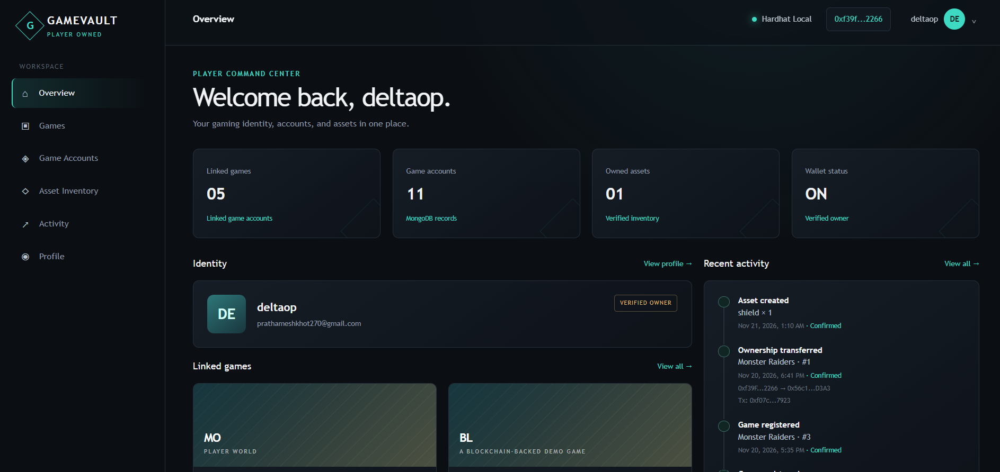

Users register and log in through the React authentication pages.

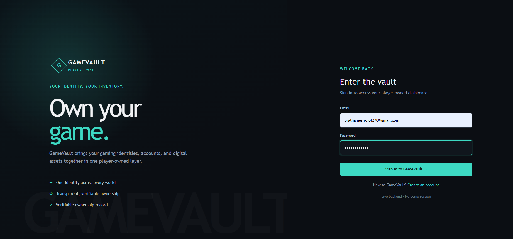

### Wallet and game registration

Users can request a signed wallet challenge and verify wallet ownership.

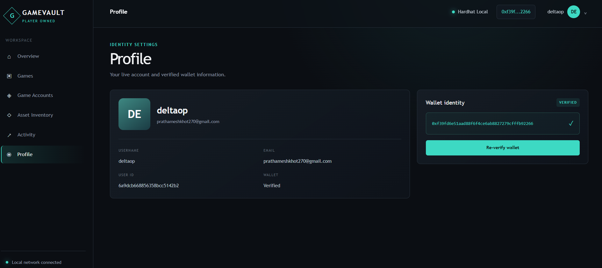


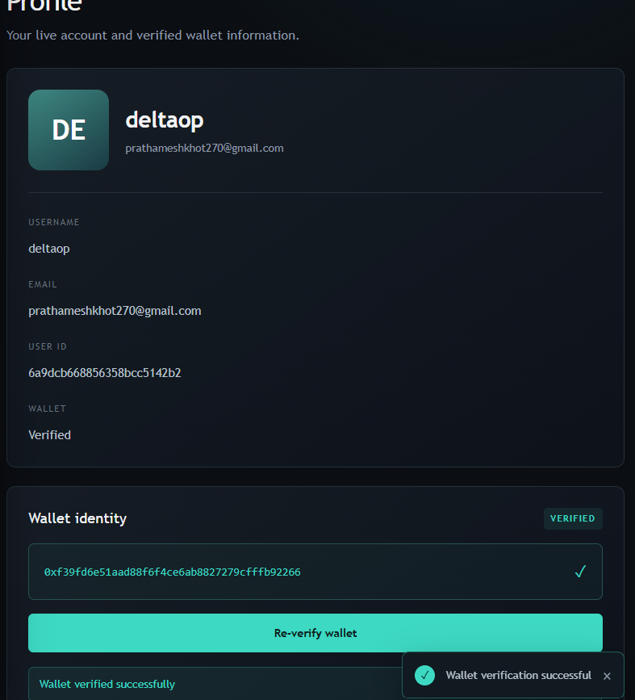

The platform admin registers a game through the Games page. The backend signer
submits the transaction rather than opening MetaMask for this operation.

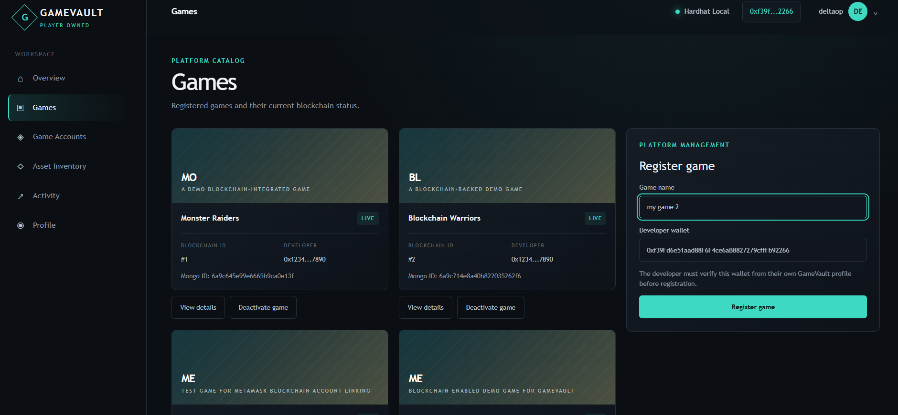


### Game account linking and relinking

The registered developer can link an external gaming account to a player-owner
wallet through MetaMask.

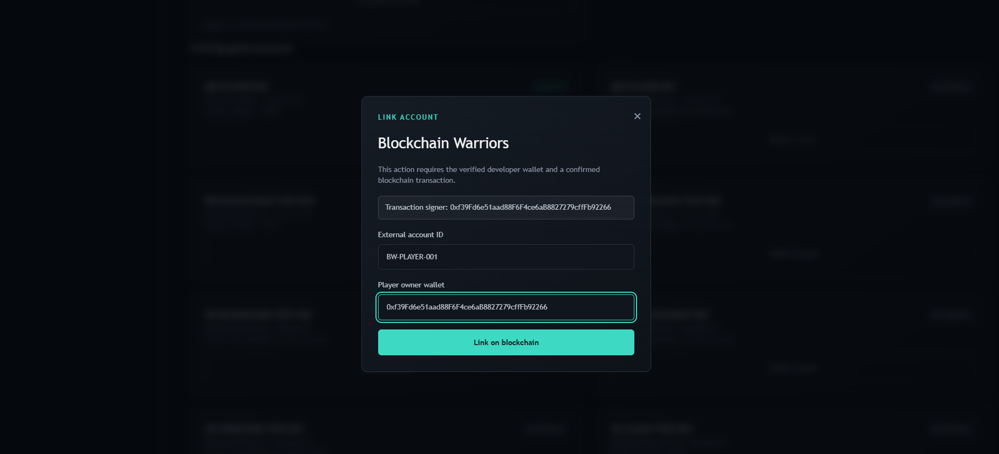

The developer wallet signs the `linkGameAccount` transaction. The separate
player owner wallet is recorded by the contract as the account owner.

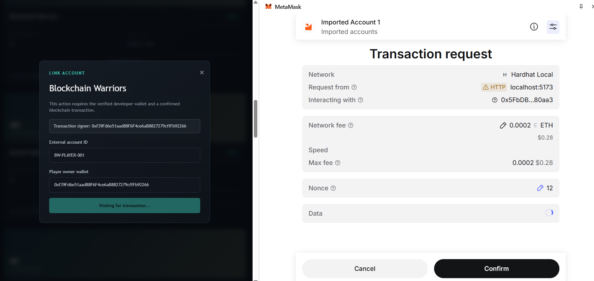

After receipt and event verification, MongoDB can reconcile the existing
historical record.


When the local Hardhat chain is restarted, historical MongoDB accounts remain
visible but are marked as not verified until they are relinked to the current
contract.

### Ownership verification and transfer

The interface reads the current owner from the smart contract before allowing
an account transfer.

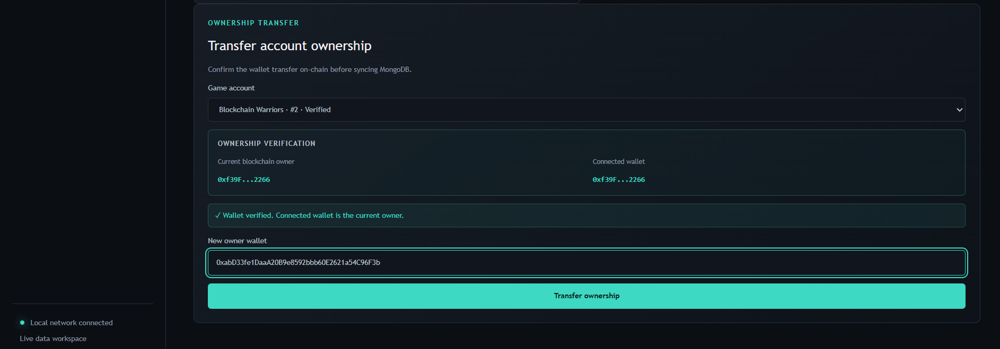

The current owner signs `transferAccount` and supplies the new owner wallet.

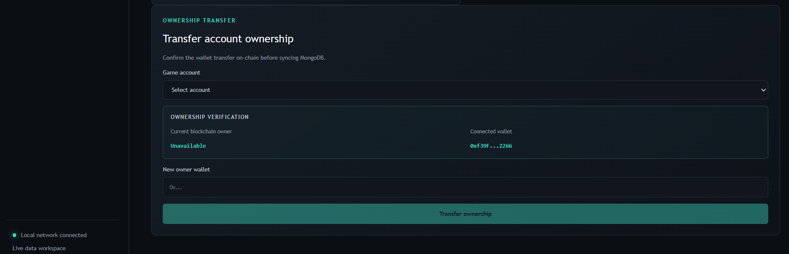

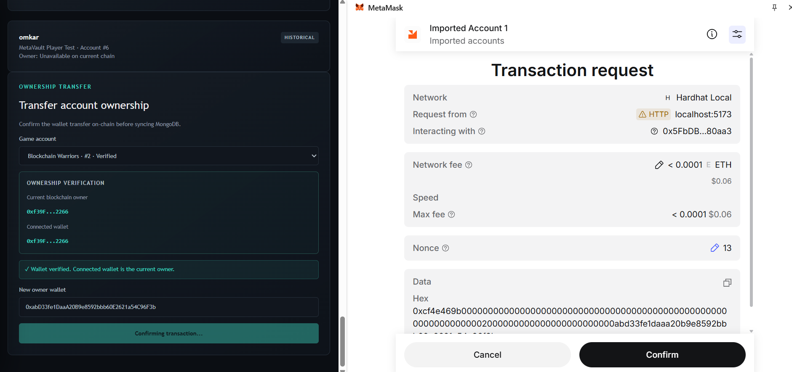

The backend verifies the transfer event and synchronizes the owner and transfer
history with MongoDB.

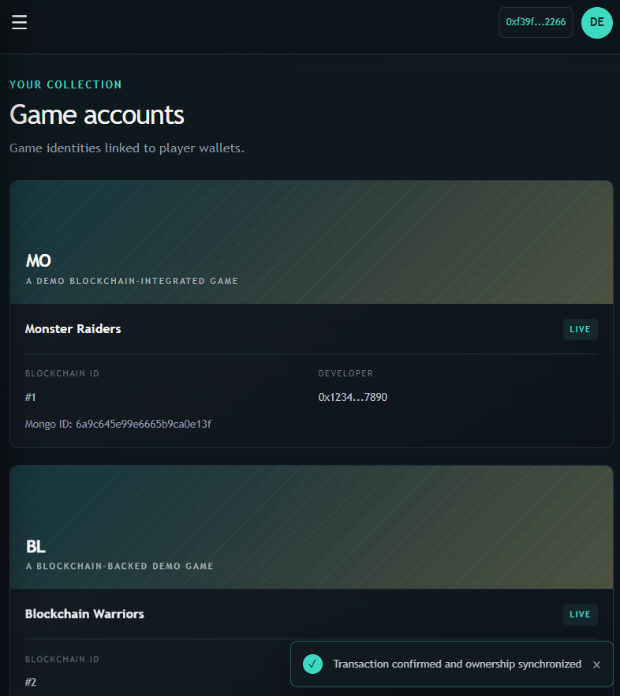

### Assets

A verified game developer can create an asset under a linked game account.

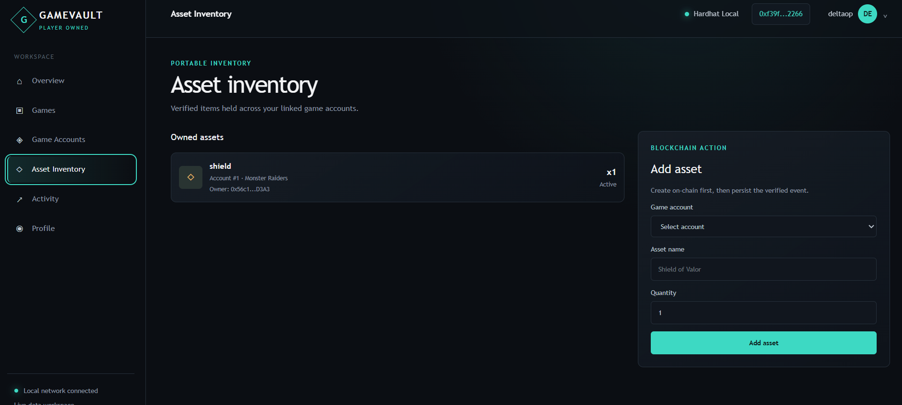

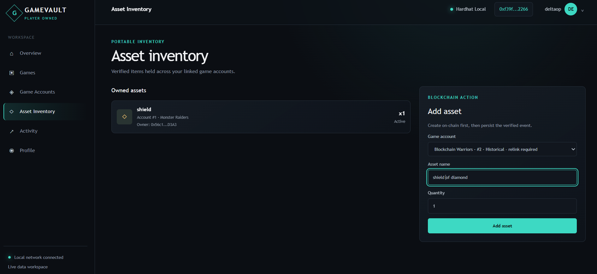


The backend verifies the `AssetAdded` event and MongoDB record before showing
the asset as successfully created.

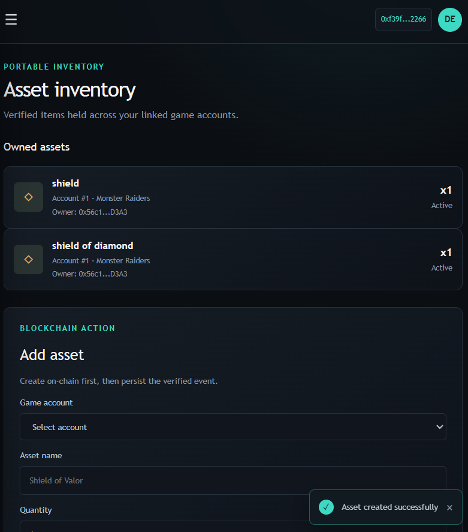

Verified developers can also activate or deactivate an asset through its
MetaMask-signed status transaction.

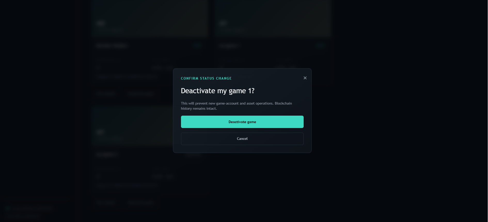

### Activity

The Activity page combines registration, account, asset and transfer history
for the loaded workspace.

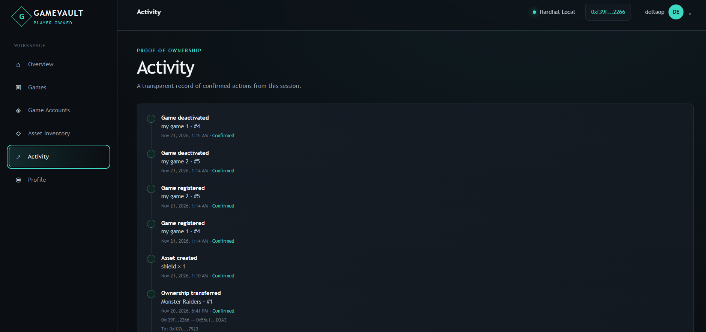

## Core Features

### Authentication and roles

- Registration and login with bcrypt password hashing
- JWT authentication for protected API routes
- A profile endpoint that derives `ADMIN`, `DEVELOPER`, or `PLAYER` role
- Platform-admin status based on the deployed contract's `admin()` address
- Developer status based on a verified wallet and the game's registered
  developer address

Frontend role checks are presentation-only. The backend and smart contract
enforce authorization.

### Game registration

- Platform admin submits the game name and developer wallet.
- The backend validates the developer wallet and that the wallet has a verified
  persisted wallet record.
- The backend signer calls `registerGame`.
- The backend waits for the receipt and reads the `GameRegistered` event.
- The event's game ID, name, developer and registered signer are verified.
- MongoDB stores the game record and registration transaction hash.

Game registration and game-status changes require the platform-admin role.

### Game account linking

- The developer selects or preloads a verified game.
- The external gaming account ID is provided.
- The player owner wallet is provided separately.
- MetaMask signs `linkGameAccount(gameId, externalAccountId, player)`.
- The contract requires `msg.sender` to equal the registered game developer.
- The contract assigns the account ID and records the supplied player address
  as the owner.
- The backend verifies the receipt, destination contract, signer, event values
  and final on-chain account state.
- MongoDB stores or updates the game-account record.

The developer signer and player owner are separate roles. The developer wallet
does not become the account owner unless it is explicitly entered as the
player owner.

### Historical account relinking

After a local Hardhat restart, MongoDB may retain account records whose old
blockchain IDs no longer exist.

Relinking allows an existing MongoDB game account to be associated with a live
game and account on the current contract:

1. The UI submits the existing MongoDB `gameAccountId`.
2. The backend verifies that the selected game is live.
3. MetaMask signs a new `linkGameAccount` transaction.
4. The transaction receipt and event are verified.
5. The existing MongoDB record is updated with the new blockchain account ID,
   owner wallet and transaction hash.

The implementation does not create a second MongoDB record for the same external
account ID and game.

### Blockchain verification

MongoDB is application storage. The smart contract is the source of truth for
supported on-chain game, account and asset state.

The backend:

- Checks transaction receipt status.
- Checks the receipt destination contract address.
- Verifies contract-originated events.
- Checks event fields against the requested operation.
- Reads final on-chain state where applicable.
- Separates confirmed blockchain success from MongoDB synchronization failure.

The UI distinguishes live blockchain records from historical MongoDB records.
Historical records are not shown as blockchain-verified without a matching live
read.

### Game-account ownership transfer

- Select a blockchain-verified game account.
- The frontend requests the current owner through the backend.
- The UI compares the current owner with the connected MetaMask wallet.
- The connected current owner enters a valid new owner wallet.
- MetaMask submits `transferAccount(accountId, newOwner)`.
- The backend verifies the receipt and
  `AccountOwnershipTransferred` event.
- The backend verifies the final on-chain owner.
- MongoDB updates `ownerWallet` and appends a transfer-history entry.

Repeated confirmation of the same transaction is handled as an already
synchronized transfer.

### Asset creation and management

- A verified developer selects a live game account.
- MetaMask submits `addAsset(accountId, name, quantity)`.
- The contract requires the game account and game to exist and belong to an
  active game, and requires the developer signer.
- The backend verifies the `AssetAdded` event and final on-chain asset fields.
- MongoDB stores the asset and creation transaction hash.

The developer can also MetaMask-sign `setAssetActive(assetId, active)`. The
contract requires the signer to be the registered game developer. The backend
verifies the status event and final on-chain state before MongoDB is updated.

Individual asset transfer is not implemented. The contract's existing
`transferAccount` operation transfers game-account ownership, not a single
asset.

### Activity and game status

- The activity page combines game registrations, account links, created assets,
  asset status changes and account transfers.
- Game-status controls require the platform admin.
- Deactivating a game through `setGameActive` prevents account and asset
  operations that depend on an active game in the contract.
- MongoDB status fields are synchronized only after confirmed blockchain
  status transactions.

The contract does not contain a separate game-account deactivation function.

## Technology Stack

| Area | Technology |
|---|---|
| Frontend | React 19, React Router, Vite, ethers.js |
| Styling | CSS and Tailwind CSS integration |
| Backend | Node.js, Express 5 |
| Authentication | JWT and bcrypt |
| Database | MongoDB and Mongoose |
| Blockchain | Solidity 0.8.34, Hardhat 3 |
| Contract deployment | Hardhat Ignition |
| Wallet | MetaMask |
| Blockchain client | ethers.js |

## Architecture

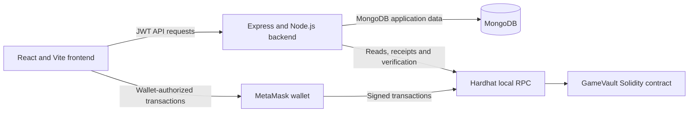

The frontend:

- Displays games, accounts, assets and activity.
- Handles MetaMask wallet connections and signing.
- Sends JWT-authenticated API requests to the backend.

The backend:

- Checks JWT authentication.
- Loads and updates MongoDB records.
- Verifies contract transactions and events.
- Uses the configured backend signer for platform-admin operations.

The contract:

- Stores games, game accounts and assets.
- Enforces admin, developer and account-owner authorization.
- Emits events used for transaction verification.

## Blockchain and MongoDB Workflow

```text
User action
    |
    v
Frontend validation and MetaMask signing when required
    |
    v
Smart contract transaction
    |
    v
Receipt and event verification
    |
    v
Final on-chain read-back where supported
    |
    v
MongoDB synchronization
    |
    v
Workspace refresh
```

MongoDB stores the application-facing data and transaction hashes. The
blockchain stores contract state and enforces permissions. A MongoDB record is
not assumed to prove live blockchain ownership.

For a confirmed transaction followed by a MongoDB save failure, the API reports
the blockchain success and reconciliation information instead of inventing a
rollback.

## Project Structure

```text
GameVault/
├── backend/
│   ├── scripts/
│   │   └── seedDemo.js
│   └── src/
│       ├── config/
│       ├── middleware/
│       ├── models/
│       ├── routes/
│       ├── services/
│       └── server.js
├── blockchain/
│   ├── contracts/
│   │   └── GameVault.sol
│   ├── ignition/
│   │   └── modules/
│   │       └── GameVault.ts
│   ├── test/
│   ├── hardhat.config.ts
│   └── package.json
├── frontend/
│   ├── src/
│   │   ├── config/
│   │   ├── services/
│   │   ├── App.jsx
│   │   └── App.css
│   └── package.json
├── screenshots/
├── .env
└── README.md
```

The repository-root `package.json` contains shared dependency entries but no
root application scripts. Commands should be run from the individual
`backend`, `frontend`, and `blockchain` directories.

## Local Setup

### Prerequisites

- Node.js and npm
- MongoDB
- MetaMask
- A terminal capable of running several local processes

### 1. Clone the repository

```powershell
git clone https://github.com/delta26052005/GameVault1.git
cd GameVault1
```

### 2. Install dependencies

```powershell
cd backend
npm install

cd ..\frontend
npm install

cd ..\blockchain
npm install
```

### 3. Configure backend and frontend environment values

The backend loads the repository-root `.env` and requires:

```dotenv
MONGODB_URI=<MongoDB connection string>
JWT_SECRET=<local JWT secret>
BLOCKCHAIN_RPC_URL=http://127.0.0.1:8545
BLOCKCHAIN_PRIVATE_KEY=<local backend signer private key>
GAMEVAULT_CONTRACT_ADDRESS=<deployed GameVault address>
```

The frontend reads `VITE_GAMEVAULT_CONTRACT_ADDRESS`. Create
`frontend/.env.local` with:

```dotenv
VITE_GAMEVAULT_CONTRACT_ADDRESS=<the same deployed GameVault address>
```

Never commit private keys, JWT secrets or MongoDB credentials.

The backend signer must be the GameVault contract's admin address for
admin-only operations.

### 4. Start MongoDB

Start MongoDB locally or configure `MONGODB_URI` for an accessible MongoDB
instance.

### 5. Start the local blockchain

```powershell
cd blockchain
npx hardhat node
```

The configured local network uses:

```text
RPC: http://127.0.0.1:8545
Chain ID: 31337
```

Keep this process running.

### 6. Deploy the contract

In a second terminal:

```powershell
cd blockchain
npm run deploy:localhost
```

This runs:

```text
hardhat ignition deploy ignition/modules/GameVault.ts --network localhost
```

Configure the generated contract address in the backend and frontend
environment files.

### 7. Start the backend

```powershell
cd backend
npm start
```

The backend listens on port `5000`. Its health endpoint is:

```text
http://localhost:5000/api/health
```

### 8. Start the frontend

```powershell
cd frontend
npm run dev
```

Open the Vite URL printed in the terminal, normally
`http://localhost:5173`.

### 9. Configure MetaMask

Add or select a local network in MetaMask:

```text
RPC URL: http://127.0.0.1:8545
Chain ID: 31337
Currency: ETH
```

Use disposable Hardhat accounts for demonstrations. Import only local
development accounts and never use real-network private keys.

After a Hardhat restart, reset the affected MetaMask account activity/nonce
state before submitting a transaction.

## Test and Validation Commands

### Smart contracts

```powershell
cd blockchain
npx hardhat compile
npm test
```

### Frontend

```powershell
cd frontend
npm run lint
npm run build
```

### Backend syntax

The backend package has a placeholder `npm test` command and does not currently
provide an implemented automated test suite.

```powershell
cd backend
node --check src/server.js
node --check src/routes/gameRoutes.js
node --check src/routes/gameAccountRoutes.js
node --check src/routes/assetRoutes.js
node --check src/services/blockchainService.js
```

MongoDB, MetaMask and end-to-end transaction behavior require manual local
testing.

## Local Demo Workflow

1. Register a user and log in.
2. Verify a wallet from the Profile page.
3. Log in as or verify the contract administrator wallet.
4. Register Monster Raiders or another game and provide a verified developer
   wallet.
5. Log in with the registered game developer.
6. Open Game Accounts and link or relink an external account.
7. Enter a separate player owner wallet when linking.
8. Add assets for a verified account.
9. Transfer game-account ownership from the current owner to another wallet.
10. Use the Activity page to review transaction-backed history.

After restarting Hardhat, previously linked on-chain accounts and games no longer
exist. MongoDB historical records remain; game and account relinking can restore
the association to the current local contract.

## Limitations

- The project is a local Hardhat demonstration, not a production deployment.
- There is no cross-chain interoperability.
- Individual asset transfer is not implemented.
- Game-account ownership transfer is implemented instead.
- MongoDB historical records are not automatically recreated on a restarted
  chain.
- There is no dedicated account-detail route or account history page.
- The contract has no separate game-account deactivation function.
- MetaMask nonce state may become stale after restarting Hardhat.
- Backend automated integration tests are not implemented.
- Production key management, monitoring and security infrastructure are not
  included.

## Future Work

- Individual asset transfer and transfer history
- Dedicated player account detail and history pages
- Automated backend and end-to-end tests
- Production blockchain deployment
- External gaming-platform integration
- Cross-chain interoperability if required
- Security auditing and key-management hardening
- Scalable transaction and reconciliation monitoring

## Author

**Prathamesh Naresh Khot**

MSc Information Technology

GitHub: [delta26052005](https://github.com/delta26052005)
